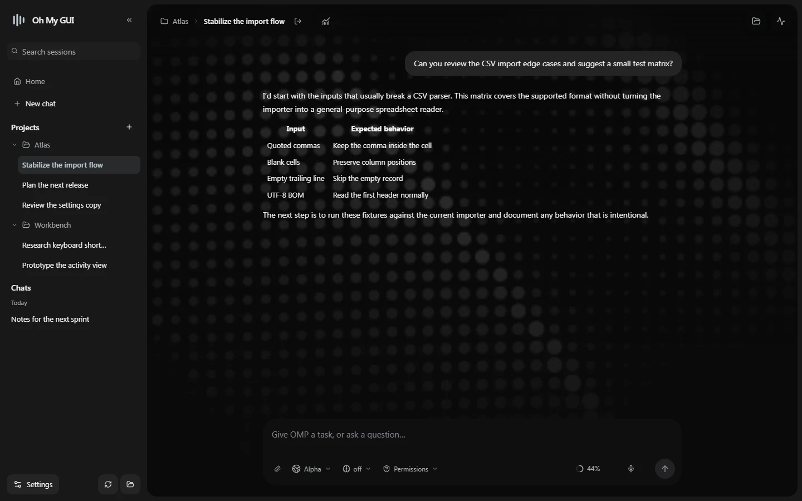
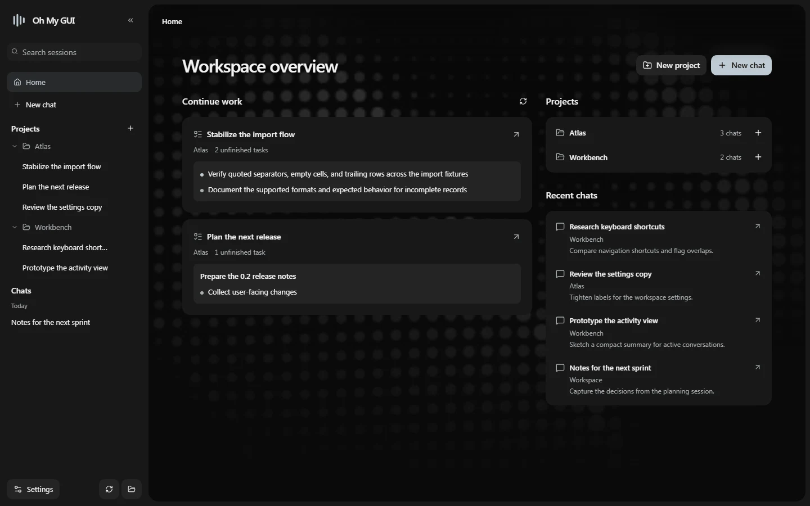
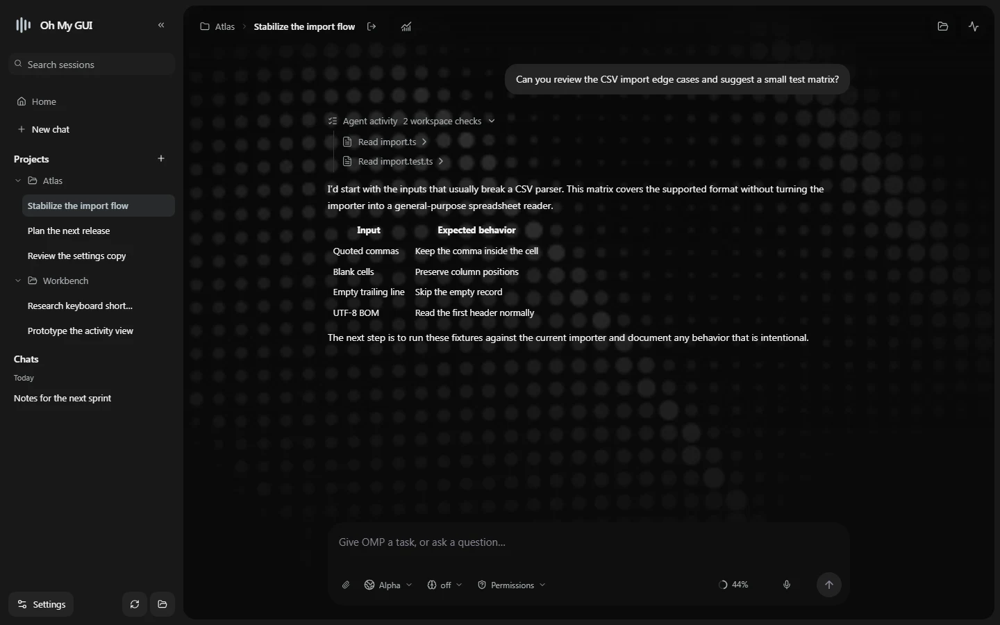
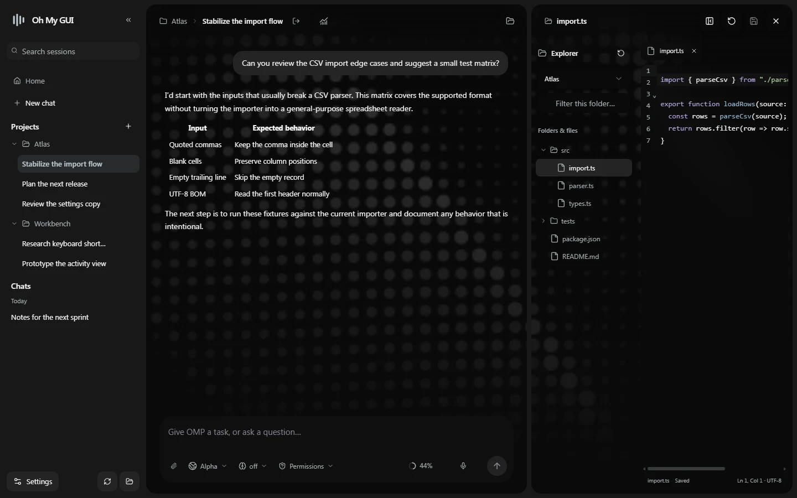
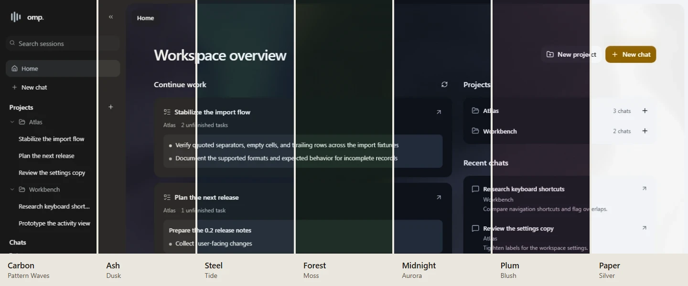
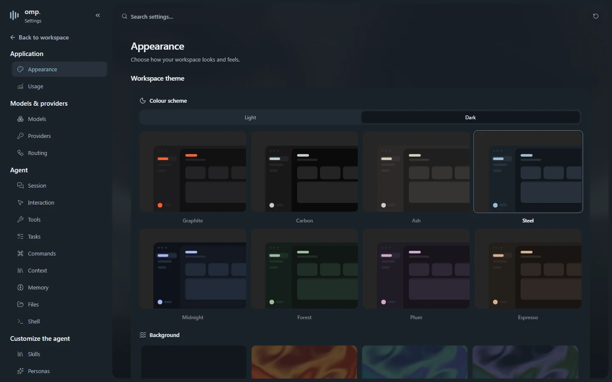

<p align="center"></p>

<h1 align="center">omp.</h1>

<p align="center"><strong>The AI harness you know. Reimagined for desktop.</strong></p>

<p align="center"><a href="https://github.com/Quaii/omp-frontend/releases">Download</a> · <a href="#showcase">Showcase</a> · <a href="#get-started">Get started</a> · <a href="DESKTOP.md">Desktop builds</a></p>

omp. brings [Oh My Pi](https://github.com/can1357/oh-my-pi) to the desktop, with project chats, live agent activity, and your files in one window. It connects to your local Oh My Pi runtime and uses the providers, models, and tools you already have configured. The same interface runs in your browser.

## Showcase

[](site/assets/project-chat.webp)

### Inside the workspace

Start from a project folder.

| Resume your work | Follow the agent | Review the project |
| --- | --- | --- |
| [](site/assets/workspace-overview.webp) | [](site/assets/project-activity.webp) | [](site/assets/project-files.webp) |
| Find running chats and unfinished tasks on Home. | Open activity, see what ran, and steer the conversation. | Open source files beside the conversation. |

### A theme for your work

[](site/assets/theme-study.webp)

### The way you want it

Make a theme your own with a custom background, accent colors, fonts, icons, scaling, corner radius, and glass effects. The [interactive Appearance demo](#project-website) uses the app’s actual settings page.

[](site/assets/appearance.webp)

## What you can do

- **Organize ongoing work.** Group chats by project, pin the ones you revisit, and pick up unfinished tasks from Home.
- **Stay in the conversation.** Inspect tool activity, queue follow-ups, steer a running turn, and revisit earlier messages.
- **Work beside your files.** Inspect changes and edit files next to the chat. The editor checks for external changes before saving.
- **Configure Oh My Pi.** Manage providers and models, assign models to roles, and work with skills, MCP servers, personas, prompts, and extensions.
- **Track usage.** Review token counts and estimated API costs, and check remaining limits for supported subscriptions.

## Get started

### Desktop

Check [GitHub Releases](https://github.com/Quaii/omp-frontend/releases) for available downloads. The Windows build uses a custom installer and first-launch setup that can offer to install or update OMP. macOS and Linux package builds and platform verification requirements are in the [desktop guide](DESKTOP.md).

### Browser or source development

Install Node.js 24 or newer and the [Oh My Pi runtime](https://github.com/can1357/oh-my-pi#install), then run:

```sh
git clone https://github.com/Quaii/omp-frontend.git
cd omp-frontend
npm ci
npm run dev
```

Open [localhost:5317](http://localhost:5317). The API runs on port 4317. For a production browser build, run `npm run build` and `npm start`, then open [localhost:4317](http://localhost:4317).

`OMP_BIN` selects a specific OMP executable. `PI_CODING_AGENT_DIR` selects the OMP agent directory, which defaults to `~/.omp/agent`. `OMP_API_TARGET` points Vite to a separate local API. `PORT` and `HOST` configure the server’s loopback address.

## How it fits together

The React interface runs in a browser or the Tauri desktop shell. A local Node server bridges HTTP and server-sent events to OMP’s JSONL RPC. The app uses the local OMP installation for sessions, configuration, and native agent actions. Model requests still go through the providers you configure. See the [GUI coverage audit](CAPABILITIES.md) for native, host-managed, and terminal-only capabilities and their verification status.

## Development

| Area | Start here |
| --- | --- |
| Interface | [web/src](web/src) and [design guide](DESIGN.md) |
| Local API and runtime bridge | [server/src](server/src) and [shared helpers](shared) |
| Desktop shell and packaging | [src-tauri](src-tauri) and [desktop guide](DESKTOP.md) |
| Contributing | [Project instructions](AGENTS.md), [agent skills](.agents/skills/README.md), and [asset credits](ASSET-CREDITS.md) |

```sh
npm run typecheck
npm test
npm run build
npm run docs:check
```

The live chat and routing checks in [scripts](scripts) use a configured model and make disposable test requests. See [GUI coverage](CAPABILITIES.md) for the isolated audit commands.

## Project website

Run `npm run site:build` and `npm run site:preview` to see the [project website](site/index.html) and its interactive Appearance demo at [localhost:57102](http://localhost:57102). The demo renders the web app’s Settings page with navigation locked to Appearance. It runs without an OMP runtime or credentials.

The [Pages workflow](.github/workflows/site-pages.yml) is manual. Once GitHub Pages is configured to use GitHub Actions, an owner can run **Publish project website** from the Actions tab. Review the site’s visibility before running it. The workflow builds and deploys `dist/site/`. [GitHub Pages configuration guide](https://docs.github.com/en/pages/getting-started-with-github-pages/configuring-a-publishing-source-for-your-github-pages-site)
